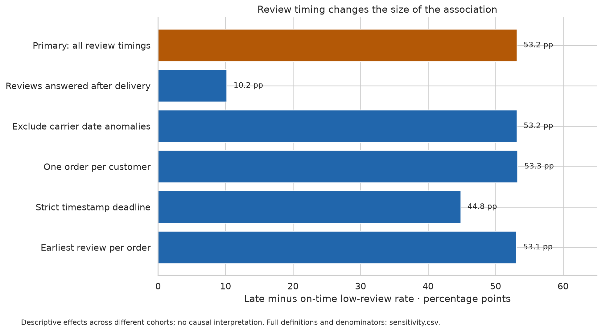

# Olist E-Commerce Delivery Reliability Analytics

**How often did Olist orders arrive late, and when did customers express dissatisfaction?** Among 96,470 eligible delivered orders, 6,534 missed the promised calendar date (6.77%). The gap in low-score rates between late and on-time orders was 53.15 percentage points across all selected reviews. Restricting the comparison to reviews answered on or after delivery reduced the gap to 10.19 points. Survey timing changes what an operations team can learn from the metric.

[Start with the source notebook](notebooks/00_source_and_relational_schema.ipynb) · [Analytical report](reports/analytical_report.md) · [SQL order model](sql/02_order_fact.sql)

## Notebook guide

| Open in order | Question |
| --- | --- |
| [00 · Source and relational schema](notebooks/00_source_and_relational_schema.ipynb) | What does each CSV row represent, and where can joins inflate counts? |
| [01 · Data quality and SQL modeling](notebooks/01_data_quality_and_sql.ipynb) | Can we preserve order-level grain and define a reliable eligible cohort? |
| [02 · Delivery KPIs and operational patterns](notebooks/02_delivery_and_satisfaction.ipynb) | How often did deliveries miss the promise, and where is the burden concentrated? |
| [03 · Review scores and timing sensitivity](notebooks/03_reviews_and_sensitivity.ipynb) | How does the low-score association change when we account for review timing? |
| [04 · Findings and operational next steps](notebooks/04_findings_and_recommendations.ipynb) | What should operations investigate and test? |



## Findings for an operations team

| Question | Historical result | Denominator or interpretation |
| --- | --- | --- |
| How reliable were delivery estimates? | 93.23% on time. Median delivery took 10.22 days. | 96,470 eligible deliveries from 99,441 orders. Eight delivered-status orders lacked usable dates. |
| Where was the greatest burden? | São Paulo (SP) had 1,820 late deliveries out of 40,494 eligible (4.49%). | The largest **count** helps prioritize workload. |
| Where was the highest rate? | Alagoas (AL) had 85 late deliveries out of 397 eligible (21.41%). | Highest **rate** among states with at least 200 eligible orders. Order mix differs by state. |
| How did reviews differ? | 3,983 / 6,381 late reviews and 8,289 / 89,443 on-time reviews scored 1–2 (62.42% vs 9.27%). | The 95% customer-cluster bootstrap interval for the difference was 51.88–54.36 percentage points. |
| What changed after delivery? | The low-score rates were 19.44% vs 9.25% in 91,171 reviewed orders. | The timing restriction selects a different group. |

For monitoring, track low scores separately for answers submitted while a customer was waiting and for those submitted after arrival. Investigate SP for volume and AL for rate before comparing carriers or promising an improvement. [Group counts](reports/tables/reviews.csv) · [State results](reports/tables/states.csv) · [Sensitivity scenarios](reports/tables/sensitivity.csv)

## Source, methods and limitations

Olist published nine anonymized marketplace CSVs covering purchases in 2016–2018. The archive and individual CSVs are identified by SHA-256. Raw bytes stay in local storage. Source-derived tables, figures and notebook outputs are shared under CC BY-NC-SA 4.0. The original code uses MIT. [Official Kaggle dataset](https://www.kaggle.com/datasets/olistbr/brazilian-ecommerce) · [Provenance and manual download](docs/data_sources.md) · [License notice](NOTICE.md)

- **Pandas and SQLite** preserve missing values, validate keys and reconcile merchandise, freight and payment totals separately. Common table expressions aggregate items and payments by order. Window functions rank reviews and count reviews per order before joining. The result has one row per original order.
- **NumPy and SciPy** estimate the late-minus-on-time low-score difference with 2,000 seeded resamples of customer clusters. Wilson intervals describe group rates. One-order-per-customer diagnostics use Cramér’s V and Cliff’s delta for the binary and ordinal comparisons.
- **Matplotlib and Seaborn** visualize purchase cohorts with volumes, state rates with intervals, review-score distributions, delivery durations and six sensitivity scenarios. [Figures](reports/figures/) · [Methods and assumptions](docs/methodology.md)

Delivery eligibility requires delivered status, usable purchase, actual and promised dates, and valid chronology. The promised day includes its full calendar day. The primary review measure uses the latest answered review per order. Nonresponse, feedback while waiting, shared time or state effects, snapshot censoring and unmeasured confounding limit inference. This observational sample supports historical comparisons. It cannot establish causal impact, savings or current performance.

## Reproduce

From the project root, use CPython 3.13 on Linux for the audited package set. For another supported Python version (3.11+), use `requirements.txt` in the install command. SQLite 3.25+ is required.

```sh
python3 -m venv .venv
. .venv/bin/activate
python -m pip install -r requirements-lock.txt
python -m pip install -e .
python -m olist_analytics all
```

The command acquires the official ZIP, audits the nine CSVs, builds SQLite, runs SQL and statistics, renders the report and figures, executes all five notebooks and runs the checks. For offline data access after dependency installation, use `python -m olist_analytics all --archive /path/to/olist_official.zip` with the original ZIP. The recorded source download succeeded without credentials. On Windows use `.venv\Scripts\Activate.ps1` for activation.

Once the pipeline has produced the local database and reports, open the notebooks with the project environment as the kernel. Each notebook can run from the project root or `notebooks/` without executing the others first. Refresh their outputs with `python -m olist_analytics notebooks`. To edit the maintained notebook source, change `scripts/create_notebooks.py`, run it to regenerate the notebooks, then refresh the outputs.

```sh
python -m unittest discover -s tests -v
python -m olist_analytics check
```

The first command runs software tests without the dataset. The second requires the completed pipeline. GitHub Actions defines software and notebook-schema checks on Python 3.11 and 3.13, plus an optional full-data run. [Workflow](.github/workflows/checks.yml) · [Model reconciliation](reports/model_validation.json) · [Final validation](reports/final_validation.json)

## Repository guide

| Location | Contents |
| --- | --- |
| [src/olist_analytics](src/olist_analytics/) and [sql](sql/) | Python stages, constrained schema, order view, KPI and segment queries |
| [notebooks](notebooks/) and [scripts](scripts/) | Five executed notebooks and their editable source generator |
| [reports](reports/) | Analytical report, six figures, ten aggregate CSVs, checks and environment |
| [docs](docs/) and [tests](tests/) | Data dictionary, methodology, source contract and test fixtures |
| `data/` | Local archive, preserved CSVs, runtime files and derived SQLite database |
