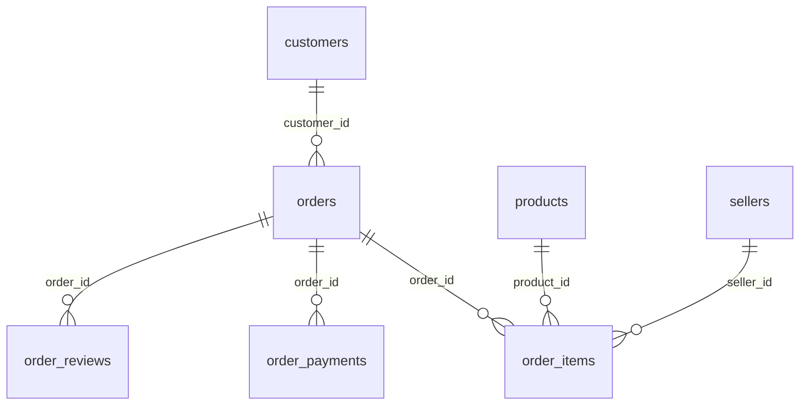

# Data dictionary and relational model

## Original table grains

| Table | Grain / key in clean model | Main role |
| --- | --- | --- |
| `orders` | `order_id` | Status and purchase/approval/handoff/actual/estimated timestamps |
| `customers` | `customer_id` | Per-order customer identifier and delivery city/state/zip prefix |
| `order_items` | `order_id`, `order_item_id` | Item product, seller, price, freight, shipping deadline |
| `order_payments` | `order_id`, `payment_sequential` | Payment records; installments and payment value |
| `order_reviews` | No assumed unique `review_id` | Review score, optional text, survey creation and answer times |
| `products` | `product_id` | Category, product dimensions and metadata |
| `sellers` | `seller_id` | Seller location |
| `geolocation` | Multiple points per zip prefix | Coordinates; audited, excluded from order model joins |
| `category_translation` | `product_category_name` | Portuguese-to-English category mapping |

Exact original columns are specified in `src/olist_analytics/config.py`. Publisher spellings such as `product_name_lenght` are preserved in the source contract. All timestamp strings use `%Y-%m-%d %H:%M:%S`; no timezone is encoded. Monetary amounts are BRL.

`customer_id` links orders to the correct delivery address record. `customer_unique_id` links repeat purchases and defines the bootstrap clustering unit. Counting distinct `customer_id` is not a valid count of unique purchasers.

The diagram describes joins; `customer_unique_id` can repeat across customer records. Category translations are a left join and need not cover every product category. Geolocation has no one-to-one zip constraint.

## Derived `order_fact` view

| Field | Meaning |
| --- | --- |
| `order_id` | Exactly one row per original order |
| `purchase_month` | `YYYY-MM` from purchase timestamp; cohort month |
| `item_count`, `seller_count` | Item rows and distinct sellers within order |
| `merchandise_value_brl` | Sum of item prices; null when no item records exist |
| `freight_value_brl` | Sum of item freight charges; not a freight rate |
| `payment_record_count`, `payment_value_brl` | Payment row count and total paid; missing payment records remain null |
| `review_score` | Latest answered review per order; null if no observed review |
| `review_count` | Number of source review records for that order after exact deduplication |
| `low_review` | 1 for score 1–2, 0 for 3–5, null for no score |
| `delivery_eligible` | Delivered status, required dates present, actual ≥ purchase timestamp, estimated date ≥ purchase date |
| `is_late` | For eligible orders: 1 if actual calendar date > estimated calendar date; otherwise 0. Null when ineligible |
| `delivery_days` | Fractional elapsed days from purchase to actual delivery; null when ineligible |
| `signed_delay_days` | Actual calendar date − estimated calendar date; negative means early |
| `carrier_chronology_anomaly` | Actual delivery precedes recorded carrier handoff |
| `carrier_before_purchase` | Carrier handoff precedes purchase |
| `review_answered_after_delivery` | 1 if answer timestamp ≥ actual timestamp, 0 if before, null when either missing |

`review_answered_after_delivery` refers to answer time, not survey creation time. Its sensitivity cohort does not imply that the survey was originally triggered after delivery.

## Output grains

`kpis.csv` is one aggregate row. `monthly.csv` and `states.csv` have mutually exclusive cohort groups; their counts reconcile to the full order model. `reviews.csv` has delivery groups among eligible orders, with score-based metrics on reviewed denominators. `category_context.csv` has distinct order/category pairs, which overlap between rows. `distributions.csv` describes eligible orders; `review_delay_bands.csv` counts selected scores across delay bands. `sensitivity.csv` contains scenario-specific cohorts; its rows are alternative definitions, not additive populations.
