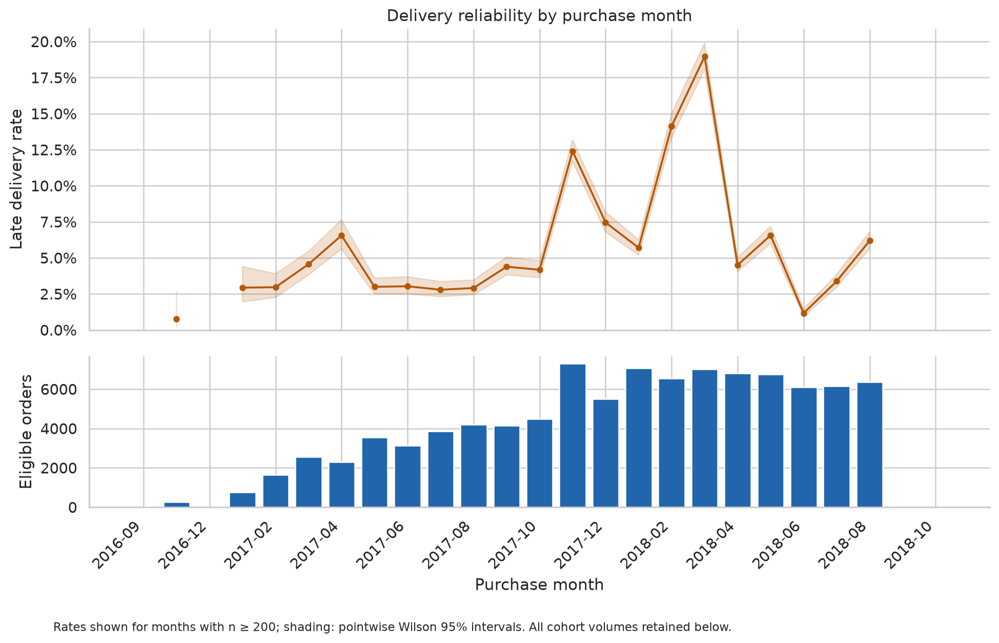
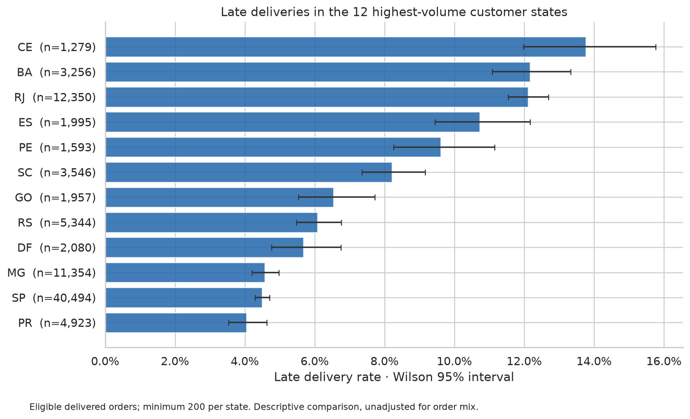
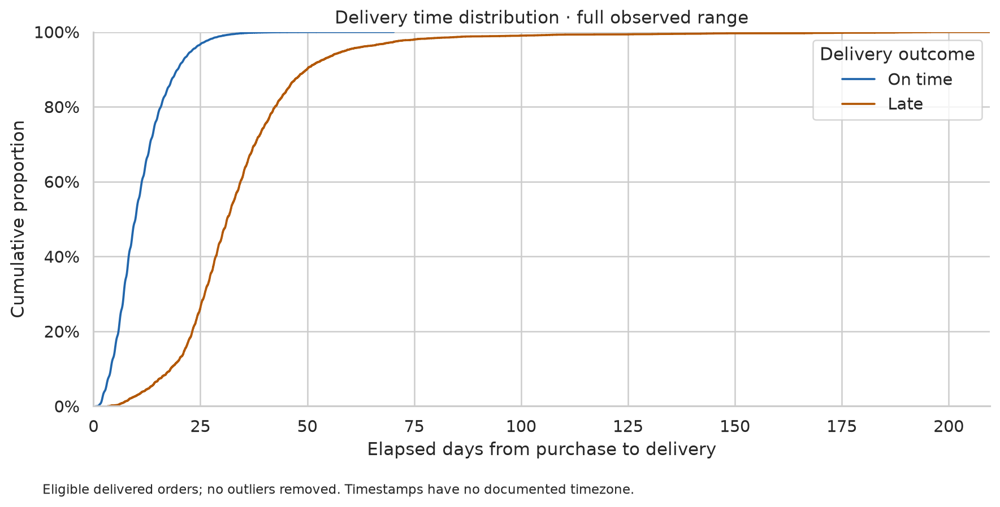
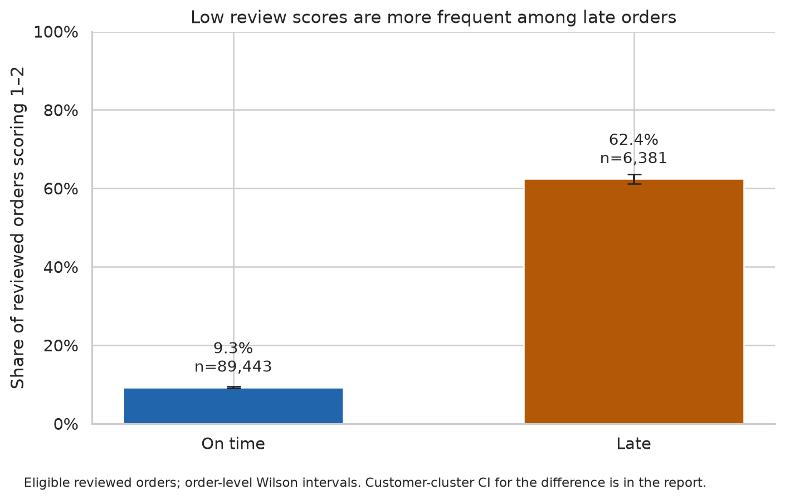
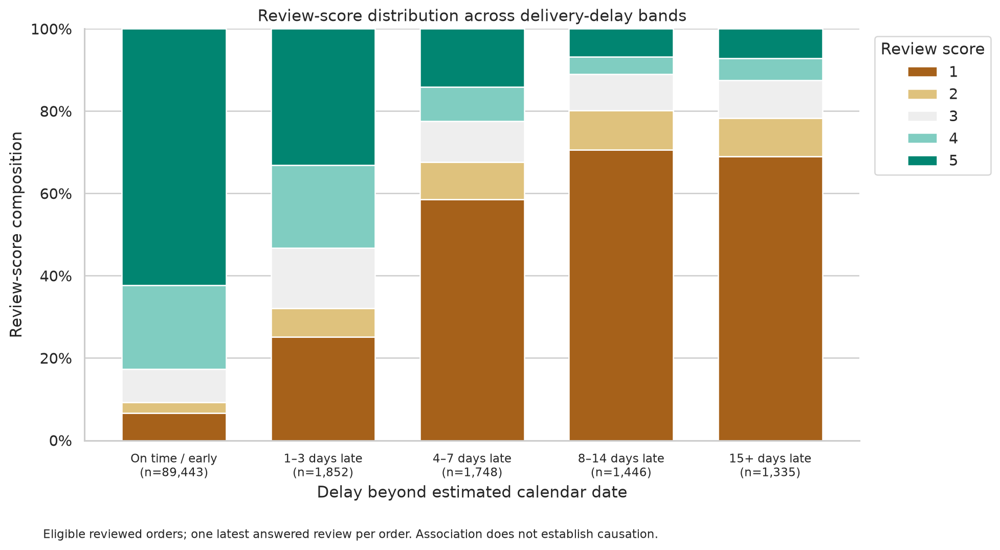
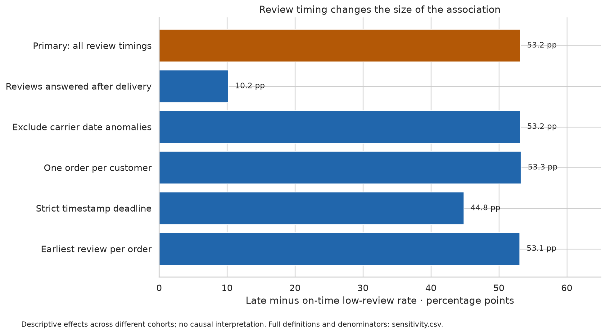

# Delivery Reliability & Customer Satisfaction — Analytical Report

Generated by `python -m olist_analytics report` from validated real-data outputs. Source acquisition: 2026-11-18T17:56:43.676220+00:00. Source purchase timestamps span 2016-09-04 21:15:19 to 2018-10-17 17:30:18; eligible delivery cohorts cover a narrower range. These are historical snapshot observations, not current Olist performance.

## Business question and decision

How often do delivered orders miss their estimated delivery date, where is the recorded burden concentrated, and how is lateness associated with customer review scores? Use these results to choose operational investigations and design prospective tests. This analysis does not estimate the causal effect or financial return of an intervention.

## Executive findings

| Metric | Observed value | Denominator / definition |
| --- | --- | --- |
| Orders | 99,441 | All original orders |
| Eligible delivered orders | 96,470 | Delivered status and valid purchase/actual/estimated dates |
| Late orders | 6,534 (6.77%) | Eligible delivered orders; calendar-day deadline |
| On-time delivery rate | 93.23% | Eligible delivered orders |
| Median delivery time | 10.22 days | Eligible delivered orders; elapsed timestamp difference |
| Eligible reviewed orders | 95,824 | Eligible delivered orders with selected score |

Among reviewed eligible orders, the low-score rate was 62.4% for late deliveries and 9.3% for on-time deliveries: a difference of **53.2 percentage points** (customer-cluster bootstrap 95% CI **51.9 to 54.4 pp**). The descriptive risk ratio is 6.74.

**Review timing materially changes the interpretation.** Restricting to reviews answered on or after actual delivery leaves 91,171 reviewed orders and reduces the difference to **10.2 pp** (19.4% versus 9.3%). The main outcome captures purchase-experience dissatisfaction, including waiting for an overdue order; it is not a pure post-delivery satisfaction measure. This restriction also selects a different cohort and does not remove confounding.

## Data quality and modeling

All nine official CSVs passed exact schema validation. Original files are unchanged; SHA-256 hashes are recorded in [source_manifest.json](source_manifest.json). All checked foreign keys resolve. Missing values were preserved rather than filled with invented dates, scores, or prices.

- Geolocation: 261,831 exact duplicate rows removed in the cleaned copy. Multiple coordinates per zip prefix remain and are not joined to orders.
- Reviews: 547 orders have multiple reviews. The latest answered review is selected deterministically; earliest-review selection is checked below. `review_id` is not treated as globally unique.
- Delivered status: 8 excluded from delivery metrics because required delivery dates are missing or invalid; see [cohort audit](tables/audit.csv).
- Eligible orders without a selected review: 646. No score is imputed.
- Recorded chronology anomalies: 23 actual deliveries preceding carrier handoff and 166 carrier handoffs preceding purchase (counts may overlap). A separate sensitivity excludes both flags.
- 4,653 eligible orders have a selected review answered before recorded actual delivery.

SQL aggregates items and payments by order before joining them to orders and one selected review. The model contains exactly one row per original order. Item prices, freight, and payments each reconcile between source tables and the order model to within one cent. They are different business measures and are not assumed to equal each other. See [model_validation.json](model_validation.json).

## Delivery patterns

Rates and pointwise Wilson intervals are displayed only for months with at least 200 eligible orders. All months and counts remain in [monthly.csv](tables/monthly.csv). Empty or incomplete edge cohorts must not be used to infer improvement. Purchase cohorts can be affected by snapshot censoring, order mix, and events not recorded here.

SP has the largest recorded late-order count (1,820 of 40,494 eligible orders; 4.49%). Among states with at least 200 eligible orders, AL has the highest late rate (21.41%, 85/397). Volume and rate answer different prioritization questions. State estimates are unadjusted for distance, seller mix, category, and season.

Category context is available in [category_context.csv](tables/category_context.csv). An order containing multiple categories appears in each category, so category counts cannot be added. Reviews and delivery outcomes belong to the entire order and cannot identify an individual seller's or item's responsibility.

## Reviews and statistical analysis

| Delivery group | Reviewed / eligible | Review coverage | Low-score rate (1–2) | Mean score |
| --- | --- | --- | --- | --- |
| On time | 89,443 / 89,936 | 99.45% | 9.27% | 4.29 |
| Late | 6,381 / 6,534 | 97.66% | 62.42% | 2.27 |

Review scores are ordinal. Low-score proportions, score distributions, and medians complement the arithmetic means. The median score is 1 for late orders and 5 for on-time orders.

The primary effect is the difference in low-score proportions. Its percentile interval uses 2,000 bootstrap resamples of 92,747 unique-customer clusters, seed 42; all orders belonging to a sampled customer stay together. This handles repeated orders by customer, but not shared state/time shocks or selection bias. Wilson intervals in charts are approximate, order-level, descriptive intervals; they are not simultaneous comparisons or adjusted causal effects.

Diagnostic tests use the earliest eligible reviewed order per customer (92,747 customers). Pearson chi-square for lateness versus low review gives Cramér's V = 0.398; the minimum expected cell count is 798.0. A two-sided, asymptotic Mann–Whitney test compares ordinal score distributions, with Cliff's delta (late minus on time) = -0.639. Diagnostic p-values: chi-square **< 1e-300 (numerical underflow)**; Mann–Whitney **< 1e-300 (numerical underflow)**. An underflowed computed zero is not mathematically zero. Large sample sizes make small p-values easy to obtain; effect sizes, selection, and review timing matter more. Mann–Whitney is not interpreted as a test of medians without additional shape assumptions. Diagnostic tests are exploratory and do not support a causal claim.

## Sensitivity analysis

| Scenario | Reviewed orders | Late low-score rate | On-time low-score rate | Difference (pp) |
| --- | --- | --- | --- | --- |
| Primary: latest answered review; calendar-day deadline | 95,824 | 62.42% | 9.27% | 53.15 |
| Review answered on/after actual delivery | 91,171 | 19.44% | 9.25% | 10.19 |
| Exclude carrier chronology anomalies | 95,637 | 62.42% | 9.26% | 53.16 |
| Earliest eligible reviewed order per customer | 92,747 | 62.55% | 9.28% | 53.27 |
| Alternative: strict timestamp deadline | 95,824 | 54.07% | 9.22% | 44.84 |
| Earliest answered review instead of latest | 95,824 | 62.36% | 9.26% | 53.10 |

The calendar-date deadline treats delivery at any time on the estimated day as on time, because estimates are recorded at midnight. A strict timestamp deadline is a documented alternative. Earliest-review and one-order-per-customer results should be compared with the primary estimate; the post-delivery restriction changes the interpretation most. All sensitivity effects are descriptive point estimates; the primary bootstrap interval is not reused for them.

## Recommended next steps

1. Investigate high-volume sources of late deliveries and high-rate states separately. Validate carrier and handoff records, route distance, and historical order mix before assigning responsibility.
2. Pilot promised-date monitoring and proactive updates for orders approaching or exceeding their deadline. Evaluate with a prospective randomized or credible quasi-experimental design; monitor on-time rate, review coverage, low-score rate, and operational cost.
3. Collect survey-trigger, answer, carrier, and actual-delivery timestamps consistently. Report waiting-period and post-delivery feedback separately; avoid combining them into one satisfaction claim.

These are proposed actions, not proven interventions. No revenue uplift, savings, or preventable complaints are estimated.

## Limitations

- Historical Olist marketplace data is not a random sample of Brazilian e-commerce and cannot describe today's performance.
- The dataset is an observational snapshot. Non-delivered orders and missing actual dates are excluded from delivery outcomes; cancellation and fulfillment performance need separate denominators.
- Review nonresponse and survey timing differ between groups. A pre-delivery response may describe a service failure while the order is still in transit. Restricting to post-delivery answers introduces additional selection.
- Lateness, product quality, seller behavior, location, and season may be related. No causal identification or adjusted effect is claimed.
- Timestamps have no documented timezone. Calculations assume one consistent clock and use elapsed calendar days, not business days.
- Confidence intervals express model-based resampling uncertainty, not a guarantee about a broader population. Multiple descriptive segments overlap; no significance rankings are claimed.
- Outliers are retained if primary date rules pass. Geolocation is audited but not used to infer routes or distance.

## Reproduction and evidence

See the [README](../README.md), [methodology](../docs/methodology.md), [source contract](../docs/data_sources.md), executable [SQL](../sql/), and [notebooks](../notebooks/). Numeric evidence is in [tables/](tables/) and [statistics.json](statistics.json). Aggregate outputs and charts are derived from the Olist dataset and are shared under its CC BY-NC-SA 4.0 terms; source CSVs are not redistributed.
